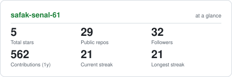
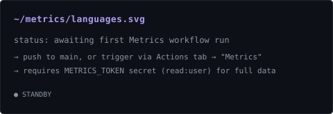
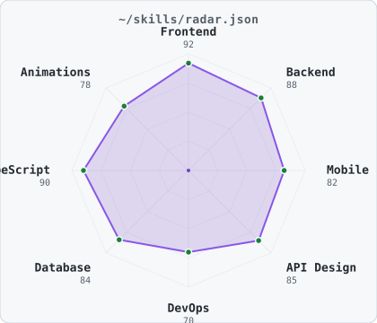

<!-- Kapak ve proje görseli: python scripts/profile/generate.py -->

  <picture>
    <source media="(max-width: 580px) and (prefers-color-scheme: dark)" srcset="assets/profile/hero-mobile-dark.svg">
    <source media="(max-width: 580px)" srcset="assets/profile/hero-mobile-light.svg">
    <source media="(prefers-color-scheme: dark)" srcset="assets/profile/hero-dark.svg">
    
  </picture>
  

    <a href="#projeler">Projeler</a> ·
    <a href="#teknolojiler">Teknolojiler</a> ·
    <a href="https://www.linkedin.com/in/safak-senal-61/">LinkedIn</a> ·
    <a href="https://x.com/safak_senal_61">X</a>
  

## Merhaba, ben Şafak

Web, iOS ve Android için uçtan uca ürünler geliştiriyorum. En sevdiğim mimari problem, üç farklı istemcinin aynı API üzerinde kendi platformuna uygun bir deneyim sunmasını sağlamak.

Şu sıralar Rust ile sistem programlama, Kubernetes ve AI ajanları üzerine çalışıyorum. React Server Components, Prisma ve FastAPI hakkında sohbet etmeye her zaman açığım.

## Projeler

<a href="https://github.com/safak-senal-61/Tavriko">
  <picture>
    <source media="(prefers-color-scheme: dark)" srcset="assets/profile/tavriko-dark.svg">
    
  </picture>
</a>

### Tavriko

Web, iOS ve Android’de oynanabilen, gerçek zamanlı çok oyunculu bilgi yarışması. React Native ve Expo ile tek istemci kod tabanı; oyun odaları ve eşleşme için Cloudflare Durable Objects ve WebSocket.

[Tarayıcıda oyna](https://tavriko-app.vercel.app/app) · [Kaynak kodu incele](https://github.com/safak-senal-61/Tavriko)

### qrders

Kafe ve restoranlar için QR menü ve sipariş yönetimi. Misafirler masadaki kodla menüye ulaşırken işletme gelen siparişleri aynı panelde takip edebiliyor.

`Next.js` `NestJS` `PostgreSQL` `Prisma` · [Kaynak kodu incele](https://github.com/safak-senal-61/qrteamcafe)

## Teknolojiler

| Alan | Kullandığım araçlar |
| :--- | :--- |
| **Web** | TypeScript, React, Next.js, Tailwind CSS |
| **Mobil** | React Native, Expo, Flutter |
| **API ve veri** | Node.js, FastAPI, REST, GraphQL, PostgreSQL, Prisma, Redis |
| **Dağıtım** | Docker, Linux, Vercel, Cloudflare Workers |

## GitHub istatistikleri

<picture>
  <source media="(prefers-color-scheme: dark)" srcset="assets/card-stats-dark.svg">
  
</picture>

Dil dağılımını ve beceri radarlarını göster

  

<picture>
  <source media="(prefers-color-scheme: dark)" srcset="assets/radar-dark.svg">
  
</picture>
<picture>
  <source media="(prefers-color-scheme: dark)" srcset="assets/radar-langs-dark.svg">
  
</picture>

